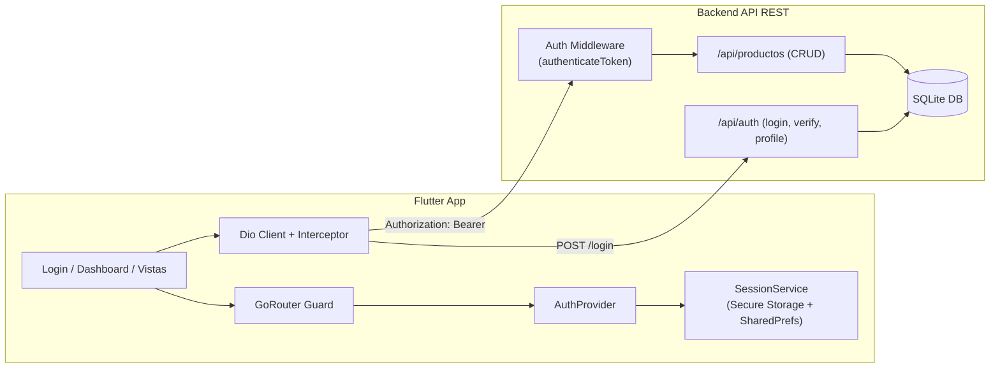

# INFORME TÉCNICO: IMPLEMENTACIÓN DE AUTENTICACIÓN JWT Y PROTECCIÓN DE SERVICIOS EN FLUTTER

**Asignatura:** Electiva Profesional I - Desarrollo de Aplicaciones Móviles  
**Programa:** Ingeniería de Sistemas  
**Institución:** Unidad Central del Valle del Cauca (UCEVA)  
**Opción Seleccionada:** Opción 1 — Continuar con el proyecto del Parcial 2 (Sistema de Gestión de Inventario)

---

## 1. Enlaces de Entrega

- **Repositorio del Proyecto (GitHub):**  
  [https://github.com/M4nnueh/sistema_gestion_inventario](https://github.com/M4nnueh/sistema_gestion_inventario)

- **Pull Request de Integración (GitFlow):**  
  [https://github.com/M4nnueh/sistema_gestion_inventario/pull/1](https://github.com/M4nnueh/sistema_gestion_inventario/pull/1)

- **Video de Sustentación y Demostración (Google Drive):**  
  [https://drive.google.com/file/d/1xB9H5ZVA_XdMaAwtjv165Fn-fbQtGpxG/view?usp=sharing](https://drive.google.com/file/d/1xB9H5ZVA_XdMaAwtjv165Fn-fbQtGpxG/view?usp=sharing)

---

## 2. Resumen Ejecutivo

El presente informe documenta el diseño, desarrollo, pruebas e integración de un sistema integral de autenticación basado en **JSON Web Tokens (JWT)** para la aplicación móvil desarrollada en **Flutter** y su correspondiente API REST desarrollada en **Node.js con Express y SQLite**.

El objetivo principal fue proteger las operaciones del sistema, garantizando que tanto a nivel de cliente (interfaz y enrutamiento) como a nivel de servidor (capa de datos y controladores) las funciones críticas y operaciones CRUD requieran credenciales válidas y un token criptográfico no manipulado.



---

## 3. Arquitectura y Tecnologías Implementadas

### 3.1. Backend (Node.js + Express + SQLite)
- **Node.js & Express:** Servidor HTTP modular con arquitectura en capas (rutas, controladores, middleware y base de datos).
- **jsonwebtoken (^9.0.2):** Generación de tokens firmados mediante algoritmo HMAC SHA256 con tiempo de expiración configurable (24 horas) a través de variables de entorno (`JWT_SECRET`).
- **bcryptjs (^2.4.3):** Cifrado unidireccional y comparación segura de contraseñas mediante función hash con salting (10 rondas), previniendo vulnerabilidades por contraseñas en texto plano.
- **SQLite (`node:sqlite` / DatabaseSync):** Motor relacional persistente en disco (`backend/data/inventario.db`) con tabla `usuarios` y semillas iniciales.
- **CORS & dotenv:** Habilitación de peticiones cruzadas para clientes web y móviles, y aislamiento de secretos de configuración.

### 3.2. Frontend (Flutter)
- **Dio (^5.11.1):** Cliente HTTP con `InterceptorsWrapper` que:
  1. Extrae de forma asíncrona el token de autenticación y lo inyecta automáticamente en el encabezado `Authorization: Bearer <token>` de cada solicitud saliente.
  2. Intercepta respuestas `401 Unauthorized` ante sesiones caducadas o tokens revocados, cerrando la sesión y limpiando el estado.
- **flutter_secure_storage (^9.2.4):** Almacenamiento seguro del token de acceso (`access_token`) cifrado en el llavero nativo del sistema operativo (Keystore en Android, Keychain en iOS/macOS, DPAPI en Windows).
- **shared_preferences (^2.3.4):** Persistencia de información no confidencial del usuario (`user_id`, `user_nombre`, `user_email`) para personalización de la interfaz.
- **GoRouter (^18.1.1):** Enrutador declarativo con guard reactivo (`redirect` sincronizado con `refreshListenable: authProvider`) que restringe el acceso a las pantallas protegidas.
- **Provider (^6.1.5+1):** Manejo de estado reactivo global mediante `AuthProvider` y `ProductoProvider`.

---

## 4. Detalle de la Implementación Técnica

### 4.1. Backend

#### Creación y Semilla de Usuarios (`backend/src/db.js`)
Se definió el esquema de usuarios con clave primaria autoincremental, restricción de unicidad en correo electrónico y contraseña hasheada:

```sql
CREATE TABLE IF NOT EXISTS usuarios (
  id INTEGER PRIMARY KEY AUTOINCREMENT,
  nombre TEXT NOT NULL,
  email TEXT NOT NULL UNIQUE,
  password TEXT NOT NULL,
  created_at TEXT NOT NULL DEFAULT (datetime('now'))
);
```
Al iniciar el servidor, se verifica la existencia de registros y se genera un usuario por defecto con credenciales:
- **Email:** `admin@inventario.com`
- **Contraseña:** `admin123` *(almacenada como hash bcrypt)*

#### Middleware de Validación JWT (`backend/src/middleware/auth.js`)
La función `authenticateToken` intercepta las peticiones, extrae el token del encabezado `Authorization: Bearer <token>` y valida su firma. Ante ausencia o invalidez, retorna respuestas con código HTTP **401**:

```javascript
function authenticateToken(req, res, next) {
  const authHeader = req.headers['authorization'];
  const token = authHeader && authHeader.split(' ')[1];

  if (!token) {
    return res.status(401).json({ message: 'Acceso denegado. Token no proporcionado.' });
  }

  try {
    const decoded = jwt.verify(token, JWT_SECRET);
    req.user = decoded;
    next();
  } catch (error) {
    if (error.name === 'TokenExpiredError') {
      return res.status(401).json({ message: 'Token expirado. Inicie sesion nuevamente.' });
    }
    return res.status(401).json({ message: 'Token invalido.' });
  }
}
```

#### Protección de Rutas CRUD (`backend/src/routes/productos.js`)
El middleware se aplicó a todas las operaciones de la entidad productos:
- `GET /api/productos`
- `GET /api/productos/:id`
- `POST /api/productos`
- `PUT /api/productos/:id`
- `DELETE /api/productos/:id`

---

### 4.2. Frontend (Flutter)

#### Separación de Responsabilidades en Almacenamiento (`SessionService`)
Cumpliendo los requisitos de seguridad, los datos sensibles se aíslan de las preferencias públicas:
- **`flutter_secure_storage`:** Almacena exclusivamente el `access_token`.
- **`shared_preferences`:** Almacena `user_id`, `user_nombre` y `user_email`.

#### Inyección Automática de Tokens (`ApiClient` con Dio Interceptor)
```dart
dio.interceptors.add(
  InterceptorsWrapper(
    onRequest: (options, handler) async {
      final token = await sessionService.getToken();
      if (token != null && token.isNotEmpty) {
        options.headers['Authorization'] = 'Bearer $token';
      }
      return handler.next(options);
    },
    onError: (DioException error, handler) async {
      if (error.response?.statusCode == 401 && !error.requestOptions.path.contains('/auth/login')) {
        await sessionService.clearSession();
        onUnauthorized?.call();
      }
      return handler.next(error);
    },
  ),
);
```

#### Control de Acceso Reactivo (`app_router.dart`)
El enrutador evalúa el estado de autenticación en cada navegación:
- Si el usuario **no está autenticado** y trata de navegar a cualquier ruta distinta de `/login`, el sistema lo redirige a `/login`.
- Si el usuario **ya está autenticado** e ingresa a `/login`, se le redirige al Dashboard (`/`).

#### Nueva Vista de Información de Sesión (`SessionScreen`)
Se diseñó la vista requerida en la sección 2.5 de la guía:
1. Nombre del usuario autenticado.
2. Correo electrónico del usuario.
3. Estado de autenticación (`Sesión activa` o `Sin sesión`).
4. Indicador de existencia de token almacenado de forma segura (sin exponer el token en texto plano).
5. Botón de **Cerrar Sesión** con diálogo de confirmación.

---

## 5. Demostración de las 7 Pruebas Obligatorias

| # | Escenario Obligatorio | Procedimiento de Prueba | Resultado Obtenido | Estado |
|---|---|---|---|:---:|
| **1** | **Acceso sin autenticación** | Se intentó acceder directamente a las rutas `/`, `/productos` y `/sesion` sin haber iniciado sesión. | El enrutador (`GoRouter`) interceptó la navegación y redirigió forzosamente a `/login`. | **Aprobado** |
| **2** | **Credenciales incorrectas** | Se intentó iniciar sesión con usuario `admin@inventario.com` y contraseña errónea `passwordInvalida`. | El backend rechazó la petición con HTTP 401; la app mostró un mensaje descriptivo de error en pantalla. | **Aprobado** |
| **3** | **Inicio de sesión correcto** | Se ingresaron las credenciales válidas `admin@inventario.com` y `admin123`. | El backend generó el JWT, el frontend lo guardó en almacenamiento seguro y navegó al Dashboard. | **Aprobado** |
| **4** | **Consumo de servicios protegidos** | Se consultó la lista de productos, se creó un nuevo ítem, se editó y se eliminó. | Todas las peticiones llevaron el encabezado `Authorization: Bearer <token>`, respondiendo HTTP 200/201/204 con persistencia real en SQLite. | **Aprobado** |
| **5** | **Persistencia de sesión** | Se cerró la aplicación completamente y se volvió a abrir. | La aplicación ejecutó `tryRestoreSession()`, verificó la vigencia del token contra `/api/auth/verify` y restauró la sesión automáticamente. | **Aprobado** |
| **6** | **Validación desde el backend** | Se realizó una petición HTTP directa mediante cURL y navegador a `http://localhost:3000/api/productos` sin encabezado Authorization. | La API retornó de inmediato código **401 Unauthorized** con el mensaje `Token no proporcionado`. | **Aprobado** |
| **7** | **Cierre de sesión** | Se pulsó el botón "Cerrar Sesión" desde el menú y desde la pantalla de sesión. | Se eliminó el token de `flutter_secure_storage` y los datos de `shared_preferences`, redirigiendo al usuario a `/login` y restringiendo nuevamente el acceso. | **Aprobado** |

---

## 6. Flujo de Trabajo GitFlow

El proyecto se gestionó siguiendo el estándar GitFlow:
1. **Rama Base:** `dev`
2. **Rama de Trabajo:** `feature/taller_jwt`
3. **Registro de Commits:** Commits atómicos y descriptivos:
   - `feat(backend): implementar autenticacion JWT y proteccion de endpoints CRUD`
   - `feat(frontend): integrar login JWT, almacenamiento seguro y proteccion de rutas con Dio`
   - `docs: actualizar README con documentacion de JWT y guia de pruebas`
   - `fix(frontend): actualizar test de widget y callback seguro en dashboard`
   - `chore(frontend): actualizar registros de plugins nativos generados`
4. **Pull Request:** Abierto y fusionado hacia `dev`:  
   👉 [Pull Request #1 en GitHub](https://github.com/M4nnueh/sistema_gestion_inventario/pull/1)
5. **Integración a Producción:** Los cambios fueron integrados finalmente en la rama `main` y sincronizados en el repositorio remoto.

---

## 7. Conclusiones

1. **Seguridad Integral:** La seguridad no recae exclusivamente en la interfaz de usuario; el backend valida de forma estricta cada solicitud mediante firmas criptográficas y tiempo de vida de tokens.
2. **Separación de Responsabilidades:** El uso combinado de `flutter_secure_storage` (para secretos/tokens) y `shared_preferences` (para metadatos de usuario) previene la filtración de credenciales sensibles.
3. **Experiencia de Usuario y Robustez:** La incorporación del interceptor de `Dio` desacopla la lógica de autenticación de las vistas y repositorios, gestionando la inyección de credenciales y la expiración de sesiones de forma transparente.
